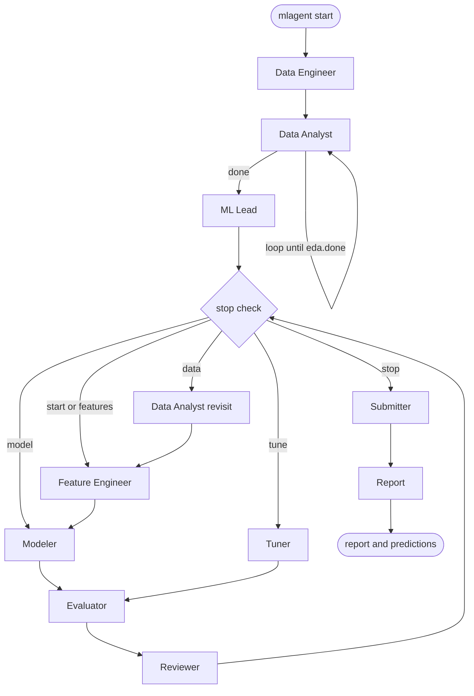

# mlagent

A multi-agent command line system that runs a machine learning project from start to finish.
You go to the project folder, run one command, say what the task is, and the agents explore the
data, plan the validation, build features, train and check models, tune the best ones, and
write a report and a predictions file. All language model calls go to a local
[Ollama](https://ollama.com) model through `langchain-ollama`. The agents are wired together
with LangGraph.

It is meant for any kind of ML task: tabular, images, text, audio, time series, supervised or
not. The agents are told what the task is in your own words, and they write the code that fits.

## Requirements

- Python 3.11 or newer (Python 3.12 tested and recommended)
- Ollama running locally (or remote endpoint), with the model from `config.yaml` already pulled (default `gemma4:31b`)
- A machine that can run the code the agents write. Image, text and audio tasks benefit from a GPU.

## Install

### Windows (PowerShell)

If PowerShell blocks script execution (`UnauthorizedAccess`), set the process execution policy first:

```powershell
Set-ExecutionPolicy -Scope Process -ExecutionPolicy Bypass
python -m venv .venv
.\.venv\Scripts\Activate.ps1
python -m pip install --upgrade pip
pip install -e .
```

### Windows (Command Prompt - cmd.exe)

```cmd
python -m venv .venv
.venv\Scripts\activate.bat
python -m pip install --upgrade pip
pip install -e .
```

### Linux or macOS

```bash
python3 -m venv .venv
source .venv/bin/activate
pip install -e .
```

### Extra Dependencies

Extra libraries for deep learning, audio, vision, and development:

```powershell
pip install -e ".[deep]"        # torch, transformers, timm, sentence-transformers
pip install -e ".[audio]"       # librosa, soundfile
pip install -e ".[vision]"      # opencv-python
pip install -e ".[dev]"         # pytest, ruff, black
```

### GPU Support on Windows (PyTorch CUDA)

The default `torch` wheel on PyPI is CPU-only on Windows. For NVIDIA GPU acceleration, install the CUDA build first before running `pip install -e ".[deep]"`:

```powershell
# Example for CUDA 12.4 (see https://pytorch.org/get-started/locally for other versions)
pip install torch torchvision --index-url https://download.pytorch.org/whl/cu124
```

Verify your Windows environment and GPU detection at any time:

```powershell
python -m mlagent.environment_probe
```

If it says `PyTorch: ... CPU only` while an NVIDIA GPU is available, the CUDA build is missing.

### Ollama on Windows

1. Download and install [Ollama for Windows](https://ollama.com/download/windows). Ollama runs as a background service at `http://localhost:11434`.
2. Open PowerShell and pull the model configured in `config.yaml`:
   ```powershell
   ollama pull gemma4:31b
   ```
3. Test connectivity in PowerShell:
   ```powershell
   Invoke-RestMethod http://localhost:11434/api/tags
   ```

The agents may also run `pip install` automatically in your environment when a library is missing. Every command they run is written to `mlagent_workspace/logs/commands.log`.

## Use

```powershell
cd C:\path\to\your\ml\project
mlagent start
```

*Note on Windows:* If the `mlagent` executable is not in your current shell `PATH`, invoke the module directly:

```powershell
python -m mlagent.cli start
# or:
python -m mlagent start
```

It asks two things, in your own words:

1. **The task**, for example: `"Predict which customers cancel next month. Train is train.csv, test is test.csv."`
2. **The metrics**, for example: `"macro F1 mainly, also report AUC"`. You may list several, or press Enter and let the agents decide.

After that it runs autonomously. It prints one line per step. When it finishes it shows where the report and the predictions are.

- **Ctrl+C** stops safely. Run `mlagent start` again and answer `resume`. An interrupted step is resumed cleanly from its beginning.
- If a workspace already exists, it asks `resume` or `fresh`. A fresh start renames the old workspace to `mlagent_workspace_old_<time>`. Nothing is deleted, and your edited `config.yaml` is carried over.
- `mlagent --version` displays version information.

## What it creates

Everything goes into one folder inside your project. Your own files are never changed.

```
mlagent_workspace/
  config.yaml     the only settings you edit
  memory/         ledger.json (all state), environment.json, progress.md (readable summary)
  logs/           run.log, llm_calls.jsonl (every prompt and answer), commands.log
  artifacts/      splits.json, features/, experiment_001/ ..., evaluation/, reviewer/
  report/         report.md and the final predictions file
```

## Settings

`config.yaml` is created on the first run:

```yaml
model:
  name: gemma4:31b                  # Ollama model tag. It must be pulled already.
  base_url: http://localhost:11434
  temperature: 0.2
  context_length: 16384             # Ollama num_ctx. Higher needs more memory.

compute:
  use_gpu: auto                     # auto = the ML Lead decides per task | always | never

limits:
  max_eda_loops: 4                  # most rounds the Data Analyst may run
  max_experiment_loops: 15          # most rounds of the experiment loop
  code_timeout_minutes: 30          # time limit for one script run
```

Everything else (code attempts per task, plateau rules, seed) is a named constant in
`mlagent/settings.py`. Every agent prompt is told the limits that matter to it.

## The team

Ten agents. Every agent that needs code hands a task to the **Coder**, which writes the script,
runs it, reads the error and fixes it.

| Agent | Job |
|---|---|
| Data Engineer | Opens the folder, reads your words, writes the project brief |
| Data Analyst | Exploratory data analysis with open questions and findings (self-loop) |
| ML Lead | Validation plan, metric, baseline, `splits.json` |
| Feature Engineer | Input preparation, screens candidate ideas on fixed splits |
| Modeler | Trains models, rejects repeated setups |
| Evaluator | Independent check of every result, hard rules and gain checks |
| Tuner | Bounded parameter search of best models (no LLM) |
| Reviewer | Evaluates rounds, tracks lessons, guides focus, and writes final report |
| Submitter | Mechanical delivery checks and optional ensemble |
| Coder | The sub-agent that writes and runs code for the others |



The loop stops for one of these reasons, decided by code and not by the language model: the
Reviewer finished (only allowed after enough rounds), the target score was reached, three runs
crashed in a row, the round limit was reached, three rounds in a row had no counted gain, or
the language model became unavailable. In every case the best approved result so far is
delivered.

A "counted gain" means a new result beats the best one by more than its noise: the mean of the
per-split improvements must exceed its standard error (three or more splits), or a small
relative margin otherwise.

## Tests

```
pip install -e ".[dev]"
pytest
ruff check .
```

The tests never need Ollama. A scripted fake model answers, a tiny fake Ollama server checks
the real request format, and the scripts the agents run really execute (pandas, scikit-learn).

## Honest limits

- It has been tested with a scripted language model only. How well your real Ollama model
  follows the prompts (one python block per answer, valid JSON) is only known from a live run.
  If a run misbehaves, `logs/llm_calls.jsonl` and `logs/run.log` show exactly what happened.
- There is no sandbox. The scripts run as you, with your permissions. The agents are told to
  keep your project folder read only and a small deny-list blocks obviously destructive shell
  commands (`rm -rf`, `shutdown` and similar), but that is a safety net and not isolation.
- The automated tests use a tabular project. The agents are written without per-data-type
  branches, but image, text and audio runs depend on your hardware and on the model writing
  good code for them.
- The time limit applies to one script run. The total time of a run is the sum of all of them.
