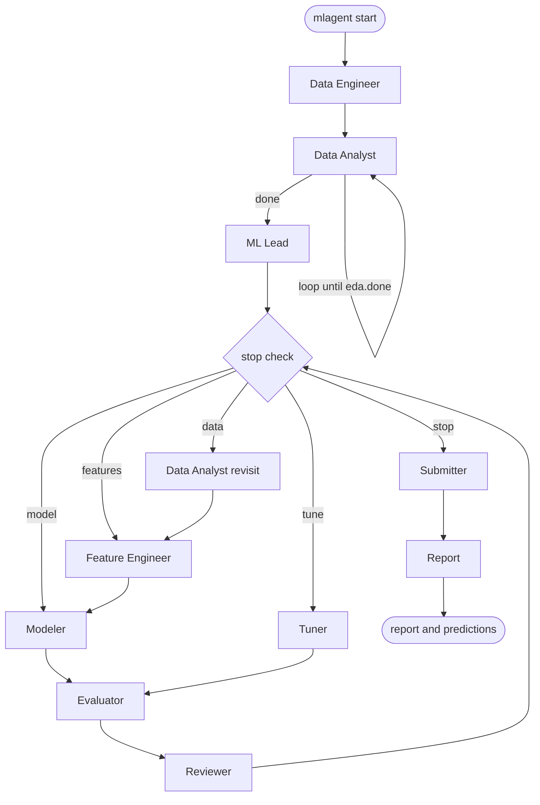

# mlagent

<p align="center">
  <a href="https://github.com/Gurumurthy30/mlagent/actions"></a>
  <a href="https://www.python.org/"></a>
  <a href="https://ollama.com"></a>
  <a href="LICENSE"></a>
</p>

<p align="center">
  <strong>An autonomous multi-agent machine learning engineering system that takes projects from raw data to validated ensemble predictions.</strong>
</p>

---

`mlagent` operates directly in your project folder. You launch one command, describe your task in natural language, and an orchestrated team of specialized agents handles the rest: exploring data, structuring cross-validation, engineering leak-free features, exploring model architectures, tuning hyperparameters, validating against leakage, and compiling final predictions with an executive technical report.

All language model calls run locally through [Ollama](https://ollama.com) via LangGraph orchestration—keeping your data and models 100% private on your machine.

---

## 💡 Key Innovations

* **Grandmaster EDA & Feature Engineering Probes**: Moves beyond basic `.describe()` checklists to automated string decomposition, group-relative stats, missingness architecture, and target-encoded features.
* **Leak-Free Fold Isolation**: Strictly enforces that all feature engineering and transformations fit inside training folds (`fit_preparation` / `apply_preparation`).
* **Robust Coder Self-Repair**: Equipped with automatic traceback fixing, library lookups, and pre-flight assertions.
* **Independent Verification & Anti-Leakage Guard**: The Evaluator independently recomputes validation scores and holdout metrics to prevent false discoveries and data leakage.
* **Full Observability & Resume Capabilities**: Live terminal UI with instant progress status, full reproducibility, and automatic resumption if interrupted.

---

## ⚡ Quickstart

Run `mlagent` directly in any directory containing your dataset:

```powershell
# 1. Navigate to your Kaggle or ML project folder
cd C:\my_kaggle_project

# 2. Launch the multi-agent pipeline
mlagent start
```

When prompted, simply describe your objective:
```
> What is the task? Predict customer churn. Train is train.csv, test is test.csv.
> What are the primary metrics? macro F1 mainly, also report AUC
```

The agents immediately probe the environment, inspect the datasets, and begin iterative development.

---

## 📦 Installation

<p>
  <a href="#-windows-cmd"></a>
  <a href="#-linux--wsl-bash"></a>
  <a href="#-macos-mac"></a>
</p>

### Select Your Platform

<details open id="-windows-cmd">
<summary><b>💻 Windows Command Prompt (cmd)</b></summary>

```cmd
python -m venv .venv
.venv\Scripts\activate.bat
python -m pip install --upgrade pip
pip install -e .
```
</details>

<details id="-linux--wsl-bash">
<summary><b>🐧 Linux / WSL (bash)</b></summary>

```bash
python3 -m venv .venv
source .venv/bin/activate
python -m pip install --upgrade pip
pip install -e .
```
</details>

<details id="-macos-mac">
<summary><b>🍎 macOS (mac)</b></summary>

```bash
python3 -m venv .venv
source .venv/bin/activate
python -m pip install --upgrade pip
pip install -e .
```
</details>

<details>
<summary><b>⚡ Windows PowerShell</b></summary>

```powershell
Set-ExecutionPolicy -Scope Process -ExecutionPolicy Bypass
python -m venv .venv
.\.venv\Scripts\Activate.ps1
python -m pip install --upgrade pip
pip install -e .
```
</details>

### Extra Dependencies

Install domain-specific packages as needed:

```bash
pip install -e ".[deep]"        # PyTorch, transformers, timm, sentence-transformers
pip install -e ".[audio]"       # librosa, soundfile
pip install -e ".[vision]"      # opencv-python
```

### 🦙 Ollama Setup

1. Download and install [Ollama](https://ollama.com). Ollama runs in the background at `http://localhost:11434`.
2. Pull the default model:
   ```bash
   ollama pull gemma4:31b
   ```
   *(You can also use other models such as `qwen2.5:32b` or `llama3.3:70b` by setting `llm.name` in `config.yaml`)*
3. Verify environment and GPU detection at any time:
   ```bash
   python -m mlagent.environment_probe
   ```

---

## 🚀 Usage & Commands

```bash
mlagent start
```

| Command | Description |
|---|---|
| `mlagent start` | Start interactive execution or resume an existing run |
| `mlagent resume [folder]` | Resume an interrupted run directly without prompting |
| `mlagent status [folder]` | Inspect current progress and scoreboard without interrupting the active run |
| `mlagent config` | Print effective configuration with source hierarchy (CLI > file > default) |
| `mlagent init-config` | Generate a starter `config.yaml` template |
| `mlagent --version` | Display version information |

### Useful CLI Flags

- `--set section.key=value`: Override any configuration parameter directly from the command line.
- `-v, --verbose`: Detailed logging output including script runs and diagnostics.
- `-q, --quiet`: Compact log output showing milestones and final results.
- `--plain`: Plain-text mode without ANSI styling or Live area (ideal for CI/CD or logging pipes).
- `-y, --yes`: Skip confirmation prompt on launch.

---

## 🤖 The Agent Team

Ten collaborative agents coordinated via LangGraph:



| Agent | Responsibility |
|---|---|
| **Data Engineer** | Inspects project directory, analyzes file schemas, and builds the initial Project Brief. |
| **Data Analyst** | Discovers correlations, distributions, data shifts, and informative missingness patterns. |
| **ML Lead** | Plans the cross-validation strategy, sets metrics, and establishes baseline description. |
| **Feature Engineer** | Designs leak-free transformation pipelines and screens candidate ideas on fixed folds. |
| **Modeler** | Explores diverse model families (LightGBM, CatBoost, XGBoost, Ridge, MLP, Ensembles). |
| **Evaluator** | Independently audits score honesty, verifies holdout generalization, and checks for leakage. |
| **Tuner** | Performs bounded Bayesian hyperparameter optimization on top-performing architectures. |
| **Reviewer** | Evaluates iteration trajectories, records empirical findings, and steers next-round focus. |
| **Submitter** | Verifies deliverable schema compliance and blends top models into final ensemble. |
| **Coder** | Sub-agent that writes, executes, and self-repairs code with automated error recovery. |

---

## 🖥️ Terminal Experience

Underneath the scrolling event log, a 3-line live status display updates in place:

1. **Stage Tracker**: `● Understand  →  ● Plan  →  ◉ Experiment (round 2/8)  →  ○ Deliver`
2. **Now**: The active agent, its current action, rationale, and runtime.
3. **Scoreboard**: Current best validation score, metric name and direction, approved runs count, and total elapsed runtime.

### End-of-Run Summary

When execution finishes, a summary panel is displayed with complete transparency:
- **Green border**: Completed successfully (`done`).
- **Amber border**: Stopped early with an approved baseline model (`budget` or user stopped).
- **Red border**: Failed without any approved model.
- Displays best model family, validation and holdout scores, key EDA findings, kept features, dead ends, trust metrics, deliverable paths, and next step copy-paste commands.

---

## 📁 Artifacts & Workspace

All outputs are saved cleanly inside a single isolated folder in your project:

```
mlagent_workspace/
  config.yaml     # Runtime configuration settings
  memory/         # ledger.json (state), progress.md (readable summary)
  logs/           # run.log, llm_calls.jsonl (prompts and answers), commands.log
  artifacts/      # splits.json, features/, experiment_001/ ..., evaluation/
  report/         # report.md and final predictions CSV
```

Your source data and files are strictly read-only and never modified.

---

## ⚙️ Configuration Reference

<details>
<summary><b>Click to expand full Configuration Reference Table</b></summary>
<br/>

| Section | Key | Default | Tier | Description |
|---|---|---|---|---|
| `llm` | `name` | `gemma4:31b` | basic | Ollama model name (e.g. gemma4:31b, qwen2.5:32b) |
| `llm` | `base_url` | `https://ollama.com` | basic | Ollama server host address |
| `llm` | `temperature` | `0.2` | advanced | Sampling temperature for the LLM |
| `llm` | `context` | `16384` | basic | Ollama context window in tokens (num_ctx) |
| `llm` | `request_timeout_seconds` | `900` | advanced | HTTP request timeout for LLM calls in seconds |
| `llm` | `retries` | `2` | advanced | Maximum retries for JSON schema repair attempts |
| `compute` | `use_gpu` | `auto` | basic | GPU utilization mode: auto (ML Lead decides per task), always, or never |
| `limits` | `max_experiment_loops` | `8` | basic | Maximum rounds of the experiment loop |
| `limits` | `max_eda_loops` | `4` | basic | Maximum rounds for Data Analyst during EDA |
| `limits` | `max_data_engineer_rounds` | `3` | advanced | Maximum rounds for Data Engineer inspection |
| `limits` | `max_data_reentries` | `2` | advanced | Maximum times EDA can be reopened on Reviewer request |
| `limits` | `code_timeout_minutes` | `30` | basic | Execution time limit for a single script run in minutes |
| `limits` | `max_code_attempts` | `5` | basic | Maximum retry attempts for Coder to fix script errors |
| `limits` | `max_consecutive_crashes` | `3` | advanced | Stop rule threshold for consecutive script crashes |
| `limits` | `tune_trial_count` | `20` | advanced | Number of Optuna tuning trials per tuning round |
| `limits` | `candidates_per_feature_round` | `15` | advanced | Maximum candidate feature ideas proposed per round (recommended 10-15) |
| `evaluation` | `score_tolerance_relative` | `0.05` | advanced | Relative mismatch allowed between logged and recomputed validation scores |
| `evaluation` | `holdout_gap_std_multiplier` | `4.0` | advanced | Multiplier of CV standard deviation allowed for holdout score drop |
| `evaluation` | `holdout_gap_relative_limit` | `0.08` | advanced | Maximum relative drop allowed on holdout score before flagging |
| `evaluation` | `large_score_jump_std_multiplier` | `4.0` | advanced | Score jump threshold (std multiplier) that triggers rejection if leakage flag is set |
| `workspace` | `workspace_folder_name` | `mlagent_workspace` | basic | Folder name inside the project directory used for artifacts and memory |
| `workspace` | `archived_workspace_prefix` | `mlagent_workspace_old_` | advanced | Prefix for archived previous workspace runs |
| `workspace` | `big_file_mb` | `200` | advanced | File size in megabytes above which files are flagged as large |
| `workspace` | `max_files_in_listing` | `40` | advanced | Maximum number of files shown in data engineer directory listing |
| `workspace` | `ignored_folders` | `['.git', '.venv', 'venv', '__pycache__', 'node_modules']` | advanced | Folder names to skip when scanning the project |
| `machine` | `low_ram_warning_gb` | `4.0` | advanced | Free system RAM in GB below which a low memory warning is shown |
| `report` | `max_words` | `900` | basic | Target word count limit for the final Markdown report |
| `ui` | `mode` | `auto` | basic | Terminal display mode: auto, rich, or plain |
| `ui` | `theme` | `dark` | basic | Color theme: dark, light, or mono |
| `ui` | `verbosity` | `normal` | basic | Event logging verbosity: quiet, normal, or detailed |
| `ui` | `timestamps` | `True` | advanced | Show timestamps on log output lines |
| `ui` | `show_environment` | `True` | advanced | Display environment probe check table on startup |
| `ui` | `confirm_before_start` | `True` | advanced | Ask confirmation before starting execution |
| `ui` | `ascii_only` | `False` | advanced | Use ASCII characters only instead of Unicode symbols |
| `ui` | `log_width` | `100` | advanced | Terminal output line width limit |

</details>

---

## ❓ Frequently Asked Questions

<details>
<summary><b>What if Ollama is not running?</b></summary>
<br/>
<code>mlagent</code> detects when the local Ollama server is unreachable and issues a clear alert prompting you to run <code>ollama serve</code> or start the Ollama desktop application. You can safely restart Ollama and run <code>mlagent start</code> to resume immediately.
</details>

<details>
<summary><b>How do I resume an interrupted run?</b></summary>
<br/>
If execution was interrupted (e.g. system reboot or <code>Ctrl+C</code>), simply navigate to the directory and run <code>mlagent resume</code> or <code>mlagent start</code> and choose <b>resume</b>. The pipeline resumes cleanly from the exact point of interruption without losing previous experiments.
</details>

<details>
<summary><b>Can I use a remote Ollama server or different model?</b></summary>
<br/>
Yes. Edit <code>mlagent_workspace/config.yaml</code> or pass flags directly:
<pre><code>mlagent start --set llm.base_url="http://192.168.1.50:11434" --set llm.name="qwen2.5:32b"</code></pre>
</details>

<details>
<summary><b>How is data leakage prevented?</b></summary>
<br/>
All preprocessing and feature statistics (medians, frequency encoders, scalers) are fit strictly on training folds inside <code>fit_preparation</code> and deterministically transformed on validation/test sets via <code>apply_preparation</code>. The Evaluator independently checks fold overlap and flags distribution shifts.
</details>

---

## 📄 License

This project is licensed under the MIT License — see the [LICENSE](LICENSE) file for details.
