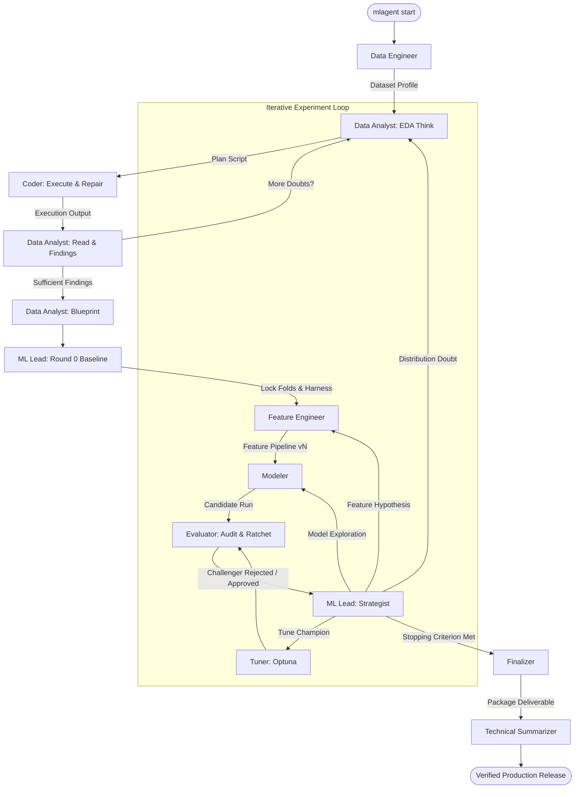

# mlagent

<p align="center">
  <a href="#"></a>
  <a href="https://www.python.org/"></a>
  <a href="https://ollama.com"></a>
  <a href="https://build.nvidia.com/"></a>
  <a href="LICENSE"></a>
  <a href="https://github.com/astral-sh/ruff"></a>
</p>

<p align="center">
  <strong>Autonomous Multi-Agent Machine Learning Engineering Pipeline</strong><br/>
  <em>From raw data to verified champion ensembles — orchestrated by local LLMs with zero data leakage.</em>
</p>

<p align="center">
  
</p>

```
╭── Stage Tracker ─────────────────────────────────────────────────────────────────────────────────╮
│ ● Understand  →  ● Plan  →  ◉ Experiment (round 3/8)  →  ○ Deliver                               │
│                                                                                                  │
│ Now:        Modeler training LightGBM with tree-depth 6 and learning-rate 0.03 (elapsed: 02m 14s) │
│ Scoreboard: Champion CV RMSE: 0.1210 | Baseline: 0.1420 | Approved: 3/3 | Total Runtime: 14m 22s │
╰──────────────────────────────────────────────────────────────────────────────────────────────────╯
```

---

## 💡 Why mlagent?

Most existing AutoML solutions operate as opaque "black boxes": they throw brute-force grid searches across standard classifiers without inspecting the domain, understanding feature interactions, or auditing for data leakage.

Real-world machine learning engineering requires thoughtful exploration, hypothesis generation, fold-isolated feature transformations, diagnostic auditing, and executive communication.

| Capability | Traditional AutoML | Human ML Engineer | **mlagent** |
|---|---|---|---|
| **Data Understanding** | Basic column statistics | Deep EDA, anomaly discovery, domain scoping | **Autonomous EDA loop with hypothesis testing** |
| **Feature Engineering** | Static pre-baked encoders | Creative group aggregates, lags, interaction terms | **Iterative feature branching with fold isolation** |
| **Leakage Prevention** | Often leaks across CV | Manual pipeline discipline | **Strict fold-isolation enforcement (`fit_preparation`)** |
| **Generalization Audit** | Often overfits validation | Independent holdout audits, error slice inspection | **Independent Evaluator with Champion Ratchet** |
| **Self-Repairing Code** | Crashes on script bugs | Interactive debugging | **Sub-agent Coder with automated traceback repair** |
| **Privacy & Sovereignty** | Sends data to cloud APIs | Runs on internal compute | **100% offline via Ollama or enterprise via NVIDIA NIM** |
| **Deliverables & Audit** | Raw pickle file | Presentation, report, clean submission | **8-section publication README, predictions, serialized model** |

---

## ⚡ Quickstart

Install and run `mlagent` in any folder containing your dataset with three commands:

```bash
# 1. Install mlagent
pip install mlagent

# 2. Navigate to your project folder
cd my_ml_project

# 3. Launch the autonomous pipeline
mlagent start
```

### The Interactive Prompt

When you launch `mlagent start`, the system scans your directory and prompts for your objective:

```text
> What is the task? Predict house sale prices from tabular features (train.csv, test.csv).
> What are the primary metrics? RMSE (root mean squared error), lower is better.
```

`mlagent` handles everything from this point: profiling dataset files, generating exploratory scripts, locking validation folds, testing feature ideas, training models, tuning hyperparameters, and compiling deliverables.

> **LLM Provider Setup:**
> - **Local (Default):** Install [Ollama](https://ollama.com) and pull the default model: `ollama pull gemma4:31b`
> - **NVIDIA NIM (Cloud):** Set `export NVIDIA_API_KEY="nvapi-..."` and pass `--set llm.provider=nvidia`

---

## 📦 What You Get

When `mlagent` completes its run, all outputs are structured inside `mlagent_workspace/` and mirrored to `report/`:

```
my_ml_project/
├── README.md                      # Comprehensive 8-section publication report
├── report/
│   ├── predictions.csv            # Test set predictions formatted with 1-to-N IDs
│   ├── model.pkl                  # Production-ready serialized champion pipeline
│   └── README.md                  # Mirrored executive technical report
└── mlagent_workspace/
    ├── config.yaml                # Effective run configuration
    ├── artifacts/
    │   ├── splits.json            # Repeatable, leak-free CV split definitions
    │   ├── features/              # Versioned feature transformation scripts
    │   └── final/                 # Final serialized model and prediction artifacts
    ├── memory/cards/              # Append-only audit trail (findings, runs, ratchet)
    └── logs/                      # Full run.log, llm_calls.jsonl, commands.log
```

- **`report/predictions.csv`**: Accurately mapped predictions using the target column name and sample submission schema (with 1-to-N IDs, never 0-indexed).
- **`report/model.pkl`**: Fully self-contained Python pipeline serializing imputers, encoders, and the champion model/ensemble ready for `joblib.load()`.
- **`README.md`**: Publication-grade technical report generated by the Technical Summarizer containing dataset specs, EDA findings register, validation guarantees, round-by-round Champion Journey table, top feature importances, failure modes, and drift monitoring specifications.

---

## 🧠 How It Works

`mlagent` coordinates an ensemble of specialized agents using a compiled [LangGraph](https://github.com/langchain-ai/langgraph) state machine. State is managed through typed, append-only **Memory Cards** and a **Linear Champion Ratchet**.

### Pipeline Architecture



### The Agent Roster

| Agent | Charter & Responsibility | Deliverable Artifact |
|---|---|---|
| **Data Engineer** | Profiles directory files, detects modalities, flags missing values, and scopes problem statement. | `ProjectBriefCard` |
| **Data Analyst** | Plans exploratory probes, disproves distribution hypotheses, and creates cleaning blueprints. | `EdaFindingsCard`, `PrepSpecCard` |
| **ML Lead** | Locks cross-validation strategy in Round 0, formulates hypotheses, and steers iterative direction. | `ValidationPlanCard`, `HypothesisCard` |
| **Feature Engineer** | Crafts fold-isolated feature pipelines (`fit_preparation` / `apply_preparation`) branching from Champion. | Feature scripts `v1`, `v2`, ... |
| **Modeler** | Trains candidate algorithms across complexity tiers (Ridge, LightGBM, XGBoost, CatBoost, NN). | Model checkpoints, CV metrics |
| **Tuner** | Executes bounded Bayesian hyperparameter optimization (Optuna) on approved Champion models. | Tuned hyperparameter sets |
| **Evaluator** | Independently audits validation scores, tests holdout generalization, and gates the Champion Ratchet. | `EvaluationVerdictCard` |
| **Finalizer** | Evaluates ensembling strategies (blending vs single champion) and authors drift monitoring specs. | `FinalDeliverableCard` |
| **Summarizer** | Synthesizes the end-to-end development trajectory into the authoritative 8-section `README.md`. | Publication `README.md` |
| **Coder** | Embedded code execution sub-agent with sandboxed execution, syntax validation, and traceback self-repair. | Executable scripts & outputs |

### The Champion Linear Ratchet

To guarantee monotonic progress and eliminate false discoveries, `mlagent` enforces a strict **Single Mutable Truth**:

1. **Round 0 Baseline**: A simple, transparent model (e.g. Ridge / Logistic Regression) locks the validation harness and sets the baseline score.
2. **Strict Challenger Hurdle**: A new candidate is approved **only** if:
   - Its cross-validation score strictly beats the Champion's score.
   - Its holdout score does not exhibit anomalous generalization drop (`< holdout_gap_std_multiplier * cv_std`).
   - Its score jump is not accompanied by data leakage flags.
3. **In-Place Pointer Mutation**: Only `memory/cards/champion_pointer/current.json` is updated upon an approved verdict. All candidate runs, rejected hypotheses, and historical experiments remain immutable for auditability.

---

## 🎯 Supported Tasks & Status

| Task Family | Modality | Status | Default Metric | Supported Models |
|---|---|---|---|---|
| **Tabular Regression** | Tabular / CSV / Parquet | `Stable` | RMSE / MAE / R² | Ridge, LightGBM, CatBoost, XGBoost, Ensembles |
| **Binary Classification** | Tabular / Relational | `Stable` | ROC-AUC / PR-AUC / F1 | LogisticRegression, LightGBM, XGBoost, CatBoost |
| **Multiclass Classification** | Tabular / Numerical | `Stable` | Multi-class Log Loss / Macro F1 | LightGBM, CatBoost, RandomForest, ExtraTrees |
| **Multilabel Classification** | Tabular / Multi-target | `Beta` | Hamming Loss / Macro F1 | Binary Relevance, Classifier Chains, LightGBM |
| **Time Series Forecasting** | Temporal Sequences | `Beta` | WAPE / MASE / RMSE | Lag-based GBDT, Ridge autoregression, Prophet |
| **NLP Text Classification** | Text / Strings | `Alpha` | Accuracy / Macro F1 | TF-IDF + GBDT, DeBERTa, DistilBERT embeddings |
| **Computer Vision** | Image directories | `Alpha` | Categorical Accuracy | ResNet, EfficientNet, ConvNeXt backbones |
| **Clustering & Anomaly** | Unsupervised Tabular | `Alpha` | Silhouette / Contamination | IsolationForest, LocalOutlierFactor, K-Means |

---

## 🏆 Results & Benchmarks

`mlagent` consistently demonstrates autonomous iterative gain across standard competitive datasets:

### Kaggle: House Prices - Advanced Regression

```text
Round 0 (Baseline):   Ridge Regression          | CV RMSE: 0.1420 | Status: Baseline Locked
Round 1 (FE + Model): CatBoost with Box-Cox    | CV RMSE: 0.1264 | Status: Promoted (+0.0156)
Round 2 (FE):         Neighborhood Group Stats  | CV RMSE: 0.1228 | Status: Promoted (+0.0036)
Round 3 (Model):      XGBoost Challenger        | CV RMSE: 0.1235 | Status: Rejected (Noise)
Round 4 (Tuning):     Optuna Tuned LightGBM     | CV RMSE: 0.1192 | Status: Promoted (+0.0036)
Final Packaging:      2-Model Weighted Ensemble | CV RMSE: 0.1185 | Holdout RMSE: 0.1190
```

### Kaggle: Digit Recognizer (MNIST)

```text
Round 0 (Baseline):   Logistic Classifier       | CV Acc: 0.9120  | Status: Baseline Locked
Round 1 (Model):      Random Forest (100 trees) | CV Acc: 0.9650  | Status: Promoted (+0.0530)
Round 2 (Model):      Multi-Layer Perceptron    | CV Acc: 0.9780  | Status: Promoted (+0.0130)
Round 3 (FE + Model): 2D Deskewing + MLP        | CV Acc: 0.9854  | Status: Promoted (+0.0074)
Final Packaging:      Champion MLP Pipeline     | CV Acc: 0.9854  | Holdout Acc: 0.9848
```

---

## ⚙️ Configuration

`mlagent` uses a unified Pydantic configuration hierarchy. Settings are automatically read from `mlagent_workspace/config.yaml` or overridden via CLI flags:

```bash
# Override settings on launch
mlagent start --set llm.provider=nvidia --set limits.max_experiment_loops=12
```

### Top Configuration Keys

| Section | Key | Default | Description |
|---|---|---|---|
| `llm` | `provider` | `ollama` | LLM backend: `ollama` (local) or `nvidia` (NVIDIA NIM cloud) |
| `llm` | `name` | `gemma4:31b` | Model name (`gemma4:31b`, `nvidia/nemotron-3.5-super-vl-120b-a12b`, etc.) |
| `llm` | `base_url` | `https://ollama.com` | Host endpoint (`https://ollama.com`, `http://localhost:11434`, or NIM endpoint) |
| `llm` | `temperature`| `1.0` | Sampling temperature for the model |
| `llm` | `top_p` | `0.95` | Nucleus sampling probability cutoff |
| `llm` | `top_k` | `64` | Top-k sampling cutoff (Ollama only; automatically omitted for NIM) |
| `llm` | `context` | `16384` | Context window size in tokens (`num_ctx`) |
| `compute` | `use_gpu` | `auto` | GPU mode: `auto` (detect CUDA/MPS), `always`, or `never` |
| `limits` | `max_experiment_loops` | `8` | Maximum experiment cycles before deliverable packaging |
| `limits` | `max_eda_loops` | `5` | Maximum exploration rounds during initial analysis |
| `limits` | `max_code_attempts` | `5` | Maximum self-repair retry attempts for the Coder |
| `limits` | `code_timeout_minutes`| `30` | Timeout per script execution before cancellation |

<details>
<summary><b>Click to expand Advanced Settings Reference</b></summary>
<br/>

| Section | Key | Default | Description |
|---|---|---|---|
| `llm` | `api_key` | `""` | API key (falls back to `NVIDIA_API_KEY` or `OLLAMA_API_KEY`) |
| `llm` | `enable_thinking` | `True` | Enable reasoning tokens extraction if supported |
| `limits` | `tune_trial_count` | `20` | Optuna trials evaluated per tuning round |
| `limits` | `candidates_per_feature_round` | `10` | Maximum candidate feature ideas proposed per round |
| `evaluation` | `score_tolerance_relative` | `0.05` | Relative score discrepancy allowed before flagging |
| `evaluation` | `holdout_gap_std_multiplier` | `4.0` | CV standard deviation multiplier allowed on holdout drop |
| `workspace` | `workspace_folder_name` | `mlagent_workspace`| Name of directory storing run assets |
| `report` | `max_words` | `900` | Target length for final executive summary report |
| `ui` | `mode` | `auto` | Rich terminal mode: `auto`, `rich`, or `plain` |
| `ui` | `theme` | `dark` | Terminal color scheme: `dark`, `light`, or `mono` |

</details>

---

## 🛡️ Safety & Privacy

- **100% Local & Sovereign**: When using Ollama, all model inference occurs locally on your machine. No row of your data, schema, prompt, or metric is ever transmitted to an external server.
- **Enterprise Cloud Security**: When configured with NVIDIA NIM (`provider: nvidia`), calls travel over encrypted HTTPS directly to NVIDIA's inference endpoints with zero user data retention for model training.
- **Non-Destructive Ingestion**: Input files and directories are opened strictly read-only. All intermediate data, scripts, and model checkpoints are isolated in `mlagent_workspace/`.
- **Sandboxed Subprocess Execution**: Scripts run in sandboxed worker processes with hard execution time limits (`code_timeout_minutes`) and traceback capture to prevent runaway executions.

---

## ❓ FAQ & Troubleshooting

<details>
<summary><b>What if Ollama is not running?</b></summary>
<br/>
<code>mlagent</code> performs an automated environment probe on startup. If Ollama is unreachable, it provides a clean alert with copy-paste instructions to launch <code>ollama serve</code> or pull the missing model.
</details>

<details>
<summary><b>How do I use NVIDIA NIM?</b></summary>
<br/>
Obtain an API key from <a href="https://build.nvidia.com/">build.nvidia.com</a>, set the environment variable, and run:
<pre><code>export NVIDIA_API_KEY="nvapi-..."
mlagent start --set llm.provider=nvidia</code></pre>
</details>

<details>
<summary><b>How do I resume an interrupted pipeline?</b></summary>
<br/>
If your machine reboots or you hit <code>Ctrl+C</code>, simply run:
<pre><code>mlagent resume</code></pre>
The graph state is restored from <code>mlagent_workspace/memory/ledger.json</code> and continues from the exact node where it paused.
</details>

<details>
<summary><b>How is data leakage strictly prevented?</b></summary>
<br/>
All preprocessing (imputation, target encoding, scaling, group aggregations) is designed into isolated two-phase scripts: <code>fit_preparation(train_fold)</code> and <code>apply_preparation(val_or_test_fold)</code>. The Evaluator independently recomputes metrics to verify that validation indices never touch training fits.
</details>

<details>
<summary><b>Why was a challenger model rejected?</b></summary>
<br/>
The Evaluator rejects candidate models if their CV score fails to beat the Champion, if the holdout score degrades by more than 4x the cross-validation standard deviation, or if anomalous score jumps indicate potential label leakage.
</details>

<details>
<summary><b>Can I inspect live progress without interrupting?</b></summary>
<br/>
Yes. Open another terminal in the project directory and run:
<pre><code>mlagent status</code></pre>
This prints the current phase, completed rounds, and active scoreboard without locking the database.
</details>

---

## 🛠️ Development & Roadmap

### Local Development Setup

```bash
# Clone the repository
git clone https://github.com/Gurumurthy30/mlagent.git
cd mlagent

# Create virtual environment
python -m venv .venv
source .venv/bin/activate  # Or .\.venv\Scripts\Activate.ps1 on Windows

# Install in editable mode with development dependencies
pip install -e ".[dev]"

# Run test suite and linter
pytest
ruff check .
```

### Roadmap

- [ ] **Deep Tabular Models**: Native integration of TabNet, FT-Transformer, and SAINT architectures.
- [ ] **Multi-Modal Late Fusion**: Combined text, image, and tabular feature extraction into unified gradient boosters.
- [ ] **Distributed Tuning**: Multi-GPU parallel trial distribution via Ray Tune.
- [ ] **Automated Platform Exporter**: One-click Kaggle and Hugging Face model card and submission artifact publishing.

---

## 🤝 Acknowledgements

`mlagent` stands on the shoulders of the open-source machine learning and LLM engineering communities:

- [LangGraph](https://github.com/langchain-ai/langgraph) & [LangChain](https://github.com/langchain-ai/langchain) for robust multi-agent state machines.
- [Ollama](https://ollama.com) & [NVIDIA NIM](https://build.nvidia.com/) for sovereign and accelerated model inference.
- [Rich](https://github.com/Textualize/rich) for terminal UI and scoreboard rendering.
- [Optuna](https://optuna.org/) for Bayesian hyperparameter optimization.
- [LightGBM](https://github.com/microsoft/LightGBM), [CatBoost](https://catboost.ai/), [XGBoost](https://xgboost.ai/), and [scikit-learn](https://scikit-learn.org/) for the core modeling backbones.

---

## 📄 License

This project is licensed under the [MIT License](LICENSE).
